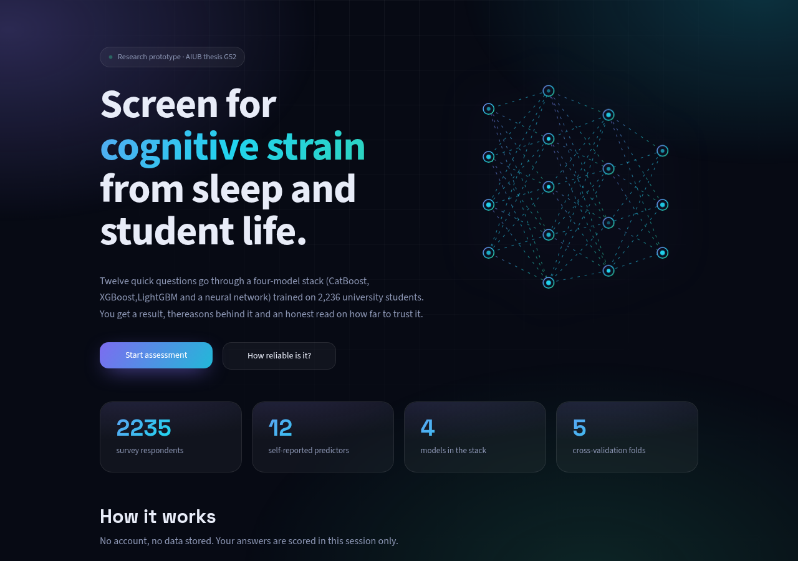
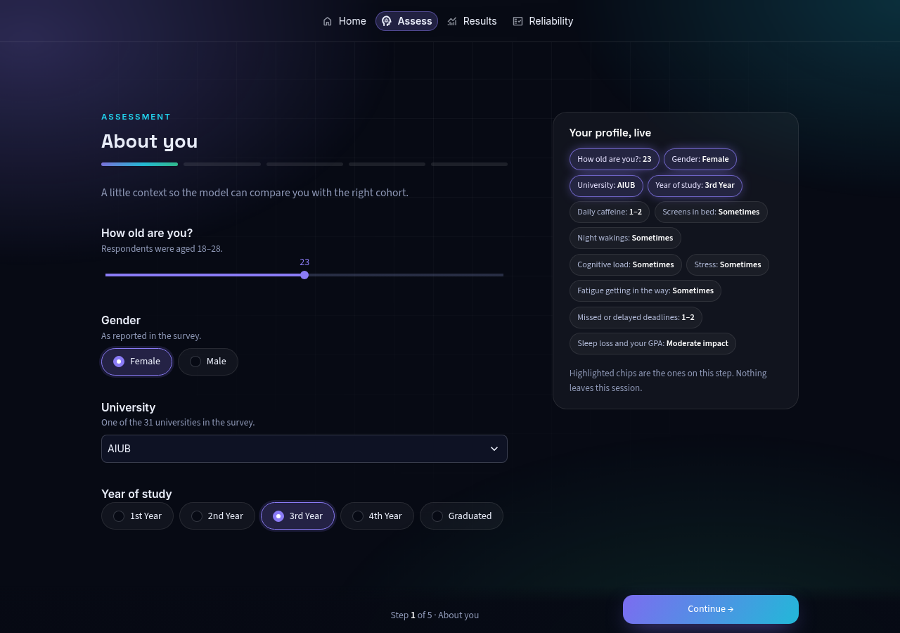
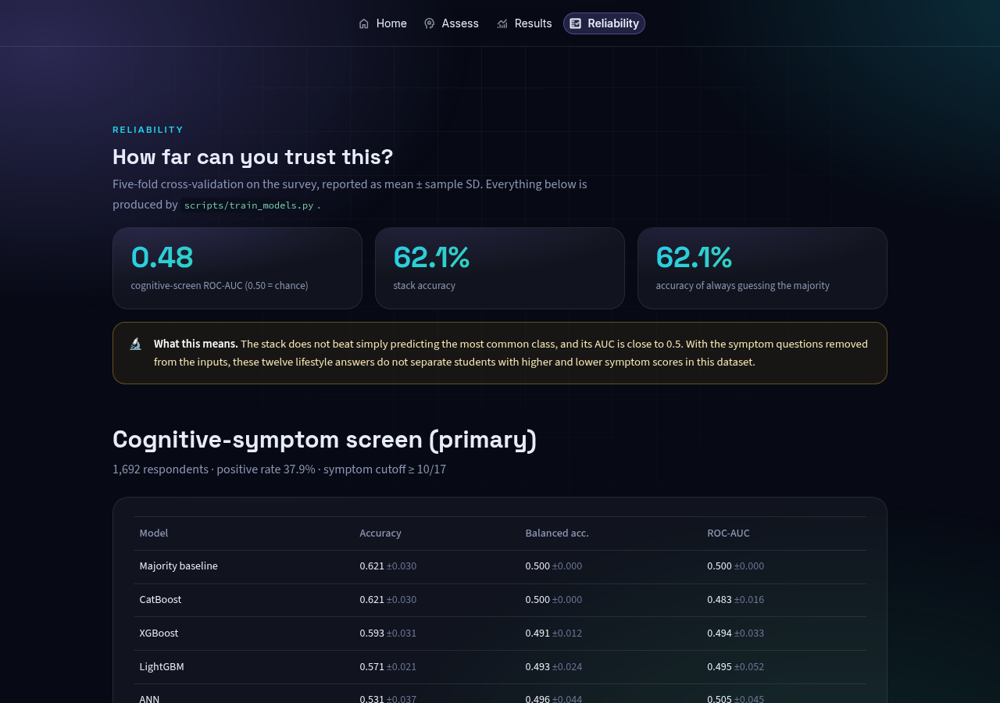
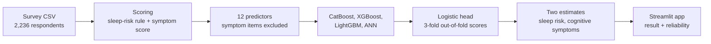

<div align="center">
  

  <p><code>Four-model stack of CatBoost, XGBoost, LightGBM and an ANN that screens sleep risk and cognitive-symptom risk in university students from 12 self-reported answers.</code></p>

  <a href="https://neuro-screen.streamlit.app/"></a>
  <a href="https://github.com/Saji-d/neuro-screen"></a>
  
  <br>
  
  
  
  
  
  
  
  
  
  

  <p>
    <a href="#-overview">Overview</a> ·
    <a href="#-highlights">Highlights</a> ·
    <a href="#-preview">Preview</a> ·
    <a href="#-pipeline">Pipeline</a> ·
    <a href="#-results">Results</a> ·
    <a href="#-tech-stack">Tech Stack</a> ·
    <a href="#-getting-started">Getting Started</a> ·
    <a href="#-project-structure">Structure</a> ·
    <a href="#-author">Author</a>
  </p>
</div>


## ◈ Overview

Neuro-Screen is a Streamlit app that takes twelve quick lifestyle answers (sleep habits, caffeine, screen use, stress, workload) and runs them through a stack of four models trained on a survey of 2,236 university students. It returns two estimates, a sleep-risk score and a cognitive-symptom score, together with the reasons behind them and a plain read on how far to trust the result.

The reference analysis lives in a notebook, and `scripts/train_models.py` reproduces its model stack from the raw survey so every number in the app can be regenerated. No data is stored: answers are scored inside the browser session only.

> [!WARNING]
> **Research prototype, not a medical device.** Labels come from self-reported survey items, not a clinical test. With the symptom and sleep-rule questions removed from the predictors, the stack does not beat the majority-class baseline, and the app says so on its Reliability page.


## ◈ Highlights

<table>
  <tr>
    <td width="33%" valign="top"><b>Four-model stack</b><br>CatBoost, XGBoost, LightGBM and a 128-64-1 PyTorch ANN, combined by a logistic head learned on 3-fold out-of-fold scores.</td>
    <td width="33%" valign="top"><b>Two screening tasks</b><br>Sleep risk on all 2,236 respondents and cognitive symptoms on the 1,692 who meet the sleep-risk rule.</td>
    <td width="33%" valign="top"><b>No label leakage</b><br>The symptom and sleep-rule questions are excluded from the predictors by design, so the label cannot leak into the model.</td>
  </tr>
  <tr>
    <td valign="top"><b>Guided assessment</b><br>A five-step wizard with a live profile panel, then a staged analysis run and a results page.</td>
    <td valign="top"><b>Honest reliability page</b><br>Five-fold cross-validation for every model against a majority-class baseline, as mean and standard deviation.</td>
    <td valign="top"><b>Private by default</b><br>Nothing is written to a database or sent anywhere else. Answers live in the session only.</td>
  </tr>
</table>


## ◈ Preview

<div align="center">
  
</div>

<br>

<table>
  <tr>
    <td align="center"><br><sub>Assessment wizard with live profile</sub></td>
    <td align="center"><br><sub>Reliability page with cross-validation results</sub></td>
  </tr>
</table>


## ◈ Pipeline



**Sleep-risk rule.** A respondent meets it if they sleep under 6 hours a night or rate their sleep quality 3 out of 5 or worse.

**Cognitive label.** A symptom score at or above the 72nd percentile of the training split, among respondents who meet the sleep-risk rule. The score comes from seven self-reported symptom questions.


## ◈ Results

All values are 5-fold cross-validation means, produced by `scripts/train_models.py` and saved in `models/eval_metrics.json`.

| Task | Majority accuracy | Stack accuracy | Stack ROC-AUC |
|---|---:|---:|---:|
| Cognitive symptoms (n = 1,692) | 0.621 | 0.621 | 0.48 |
| Sleep risk (n = 2,236) | 0.757 | 0.757 | 0.49 |

**Cognitive-symptom screen**, mean ± sample SD over 5 folds:

| Model | Accuracy | Balanced accuracy | ROC-AUC |
|---|---:|---:|---:|
| Majority baseline | 0.621 ± 0.030 | 0.500 ± 0.000 | 0.500 ± 0.000 |
| CatBoost | 0.621 ± 0.030 | 0.500 ± 0.000 | 0.483 ± 0.016 |
| XGBoost | 0.593 ± 0.031 | 0.491 ± 0.012 | 0.494 ± 0.033 |
| LightGBM | 0.571 ± 0.021 | 0.493 ± 0.024 | 0.495 ± 0.052 |
| ANN | 0.531 ± 0.037 | 0.496 ± 0.044 | 0.505 ± 0.045 |
| Four-model stack | 0.621 ± 0.030 | 0.500 ± 0.000 | 0.480 ± 0.033 |

> [!NOTE]
> Every model lands at chance level. With the symptom questions removed from the inputs, these twelve lifestyle answers do not separate students with higher and lower symptom scores in this dataset, so the scores should be read as a conversation starter, not a conclusion. The sleep-risk table is on the app's **Reliability** page.


## ◈ Tech Stack

| Layer | Technologies | Purpose |
|---|---|---|
| App | Streamlit, Plotly | Top-navigation interface, assessment wizard and charts |
| Tree models | CatBoost, XGBoost, LightGBM | Three gradient-boosted base learners |
| Neural network | PyTorch | 128-64-1 ANN base learner |
| Stacking | scikit-learn | Logistic head, cross-validation and metrics |
| Data | pandas, NumPy | Survey scoring and feature preparation |


## ◈ Getting Started

**Prerequisites:** Python 3. The survey CSV is included in `data/`.

```bash
git clone https://github.com/Saji-d/neuro-screen.git
cd neuro-screen
pip install -r requirements.txt
python scripts/train_models.py      # writes models/ (add --skip-cv for a fast fit)
streamlit run app.py
```

Package versions are pinned in `requirements.txt` because the scikit-learn pickles must load with the version that trained them.


## ◈ Project Structure

`notebooks/thesis-updated-code.ipynb` is the reference analysis. `scripts/train_models.py` reproduces its four-model stack.

```text
.
├── app.py                    # Streamlit shell with top navigation
├── config.py                 # paths and brand
├── modules/
│   ├── ml/                   # survey scoring and the stack (train and load)
│   ├── predictor.py          # the single inference path
│   └── ui/                   # theme, components and pages (home, assess, results, reliability)
├── scripts/train_models.py   # training and cross-validation
├── models/                   # trained artifacts and eval_metrics.json
├── notebooks/                # reference analysis
├── data/                     # survey CSV
├── docs/                     # preview screenshots
├── assets/                   # banner, divider and stylesheet
└── README.md
```


## ◈ Author

**Sajidur Rahman Sajid**: Full-Stack Developer and AI engineer from Dhaka.<br>
BSc in CSE at American International University-Bangladesh (AIUB).

The survey dataset and the reference analysis (`notebooks/thesis-updated-code.ipynb`) come from a group project at AIUB. This app and repository are my own work.

<p>
  <a href="https://www.sajidur.me"></a>
  <a href="https://www.linkedin.com/in/sajidur-rahman-sajid/"></a>
  <a href="https://github.com/Saji-d"></a>
  <a href="mailto:sajidsajidurrahman99@gmail.com"></a>
</p>

<sub>A research prototype, shared as it was built. Not for clinical use.</sub>
