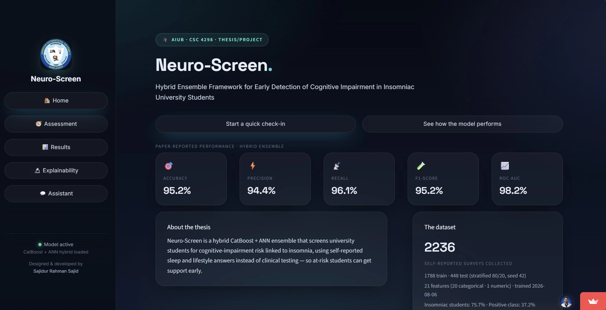
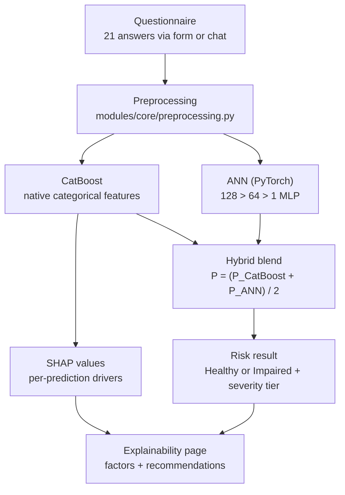
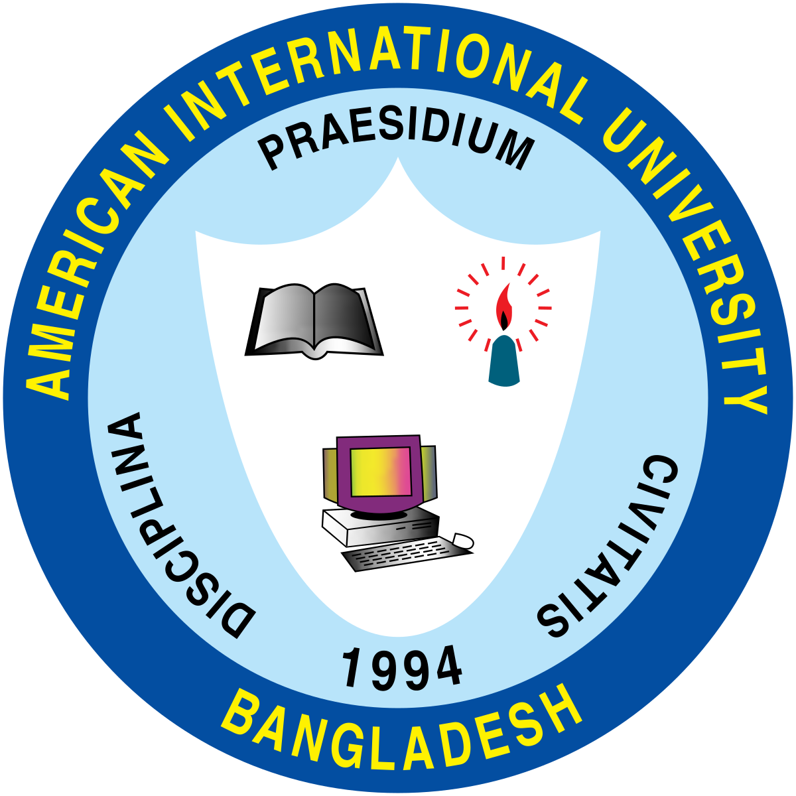

<div align="center">
  

  <p><code>Hybrid CatBoost + ANN framework that screens cognitive impairment risk in insomniac university students, with explainable predictions.</code></p>

  <a href="https://neuro-screen.streamlit.app/"></a>
  <a href="https://github.com/Saji-d/neuro-screen"></a>
  
  <br>
  
  
  
  
  
  

  <p>
    <a href="#-overview">Overview</a> ·
    <a href="#-highlights">Highlights</a> ·
    <a href="#-preview">Preview</a> ·
    <a href="#-architecture">Architecture</a> ·
    <a href="#-results">Results</a> ·
    <a href="#-tech-stack">Tech Stack</a> ·
    <a href="#-getting-started">Getting Started</a> ·
    <a href="#-project-structure">Structure</a> ·
    <a href="#-author">Author</a>
  </p>
</div>



> [!WARNING]
> **Neuro-Screen is a research prototype, not a medical device.** It is not a diagnostic tool, has not been clinically validated and must not replace a professional assessment. If you are struggling with sleep, memory or your mental health, please talk to a qualified professional.

## ◈ Overview

Sleep loss is common among university students and is linked to memory lapses, poor focus and slower decisions. Neuro-Screen is the undergraduate thesis project (AIUB, Group G52) that asks a simple question: can a short self-reported questionnaire about sleep and lifestyle flag students whose answers resemble cognitive impairment, early enough to point them toward academic or psychological support?

A student answers 21 questions through a form or a guided chat. The answers go through one inference path: a CatBoost model and a PyTorch ANN each produce a probability and the two are averaged into a hybrid risk score. The result page shows the score, a severity tier, the per-model breakdown and the factors that pushed the prediction up or down.

- **Who it is for:** researchers and students exploring ML-based screening on survey data.
- **What it is not:** a clinical tool. The label comes from self-reported symptom questions, not from a clinical test.


## ◈ Highlights

<table>
  <tr>
    <td width="33%"><b>Hybrid ensemble</b><br>CatBoost on native categoricals plus a 128-64-1 ANN, blended by mean probability.</td>
    <td width="33%"><b>One inference path</b><br>The form and the chat call the same predictor. No mock or random scoring.</td>
    <td width="33%"><b>Per-prediction SHAP</b><br>Signed feature contributions from the trained CatBoost model for each answer set.</td>
  </tr>
  <tr>
    <td><b>Guided chat check-in</b><br>Rule-based assistant that parses natural answers such as "around 5 hours". It is not an LLM.</td>
    <td><b>Crisis safety redirect</b><br>The chat intercepts self-harm language and points to help instead of scoring.</td>
    <td><b>Reported vs live metrics</b><br>Paper numbers and numbers recomputed from the shipped artifacts are labelled separately.</td>
  </tr>
  <tr>
    <td><b>Reproducible training</b><br><code>scripts/train_models.py</code> rebuilds every artifact and <code>verify_predictions.py</code> checks parity.</td>
    <td><b>Native multipage app</b><br>Home, Assessment, Results, Explainability and Assistant pages on Streamlit routing.</td>
    <td><b>Honest framing</b><br>Disclaimers on the app and in this README. Screening, never diagnosis.</td>
  </tr>
</table>


## ◈ Preview

<div align="center">
  
  <br>
  <sub>Try the interactive app: <a href="https://neuro-screen.streamlit.app/">neuro-screen.streamlit.app</a></sub>
</div>


## ◈ Architecture



```text
prediction = "Impaired" if P_hybrid >= 0.5 else "Healthy"
```

**The label.** The target `cognitive_impairment` is derived from seven self-reported symptom questions (mental stamina, spacing out, audio lag, forgetfulness, reminder reliance, brain fog and decision making). They are summed into a cumulative score and binarized at its 72nd percentile.

**The models.** CatBoost (800 iterations, depth 5, learning rate 0.002) trains on the raw categorical answers. The ANN (ReLU hidden layers, sigmoid output, dropout 0.6 and 0.4, Adam, 40 epochs) trains on one-hot encoded and scaled features. Both use an 80/20 stratified split with seed 42.


## ◈ Results

Published in the thesis report and the ICCA 2026 conference paper, evaluated on the held-out test split (447 of 2,237 survey responses):

| Model | Accuracy | Precision | Recall | F1 | ROC-AUC |
|---|---:|---:|---:|---:|---:|
| CatBoost | 94.12% | 93.80% | 95.00% | 94.39% | 0.9780 |
| ANN | 91.25% | 89.50% | 92.00% | 90.73% | 0.9450 |
| **Hybrid (Neuro-Screen)** | **95.20%** | **94.40%** | **96.10%** | **95.24%** | **0.9820** |

| Dataset fact | Value |
|---|---|
| Survey responses (thesis) | 2,237 from university students aged 20 to 35 in Bangladesh |
| Split | 1,790 train and 447 test, stratified, seed 42 |
| Self-reported insomniac | about 75.7% |
| Labelled impaired | about 37.1% |

> [!NOTE]
> The `data/Thesis Dataset.csv` file in this repository has 2,236 rows, and the shipped model artifacts were retrained on it (1,788 train and 448 test). The Explainability page therefore shows two sets of numbers: the published thesis figures above and the live figures recomputed from the shipped artifacts, which differ. The labels are self-reported, so every figure measures agreement with a survey-derived label and says nothing about clinical accuracy.


## ◈ Tech Stack

| Layer | Technologies | Purpose |
|---|---|---|
| App | Streamlit (native multipage) | Landing, assessment, results, explainability and chat pages |
| Gradient boosting | CatBoost | Primary classifier and SHAP values |
| Neural network | PyTorch | 3-layer ANN that complements CatBoost |
| ML utilities | scikit-learn, pandas, NumPy | Splits, scaling, encoders and metrics |
| Charts | Plotly | Risk meter, ROC curve, importances and SHAP bars |
| Language | Python 3.11 | Whole project |


## ◈ Getting Started

**Prerequisites:** Python 3.11 and git. No environment variables or API keys are needed.

```bash
git clone https://github.com/Saji-d/neuro-screen.git
cd neuro-screen
python -m venv .venv
```

```powershell
# Windows
.venv\Scripts\Activate.ps1
```

```bash
# macOS and Linux
source .venv/bin/activate
```

```bash
pip install -r requirements.txt
streamlit run app.py
```

Trained artifacts already ship in `models/`, so predictions work out of the box. To retrain and check parity:

```bash
python scripts/train_models.py
python scripts/verify_predictions.py
```


## ◈ Project Structure

The app shell sits in `app.py`, the model code in `modules/`, trained artifacts in `models/`, the survey data in `data/` and the training scripts in `scripts/`.

<details>
<summary>Open the folder map</summary>

```text
neuro-screen/
├── app.py                      # page shell, theme and multipage router
├── config.py                   # paths, brand, risk thresholds
├── data/
│   ├── Thesis Dataset.csv      # survey dataset
│   ├── feature_schema.json     # question to model column mapping
│   └── reported_results.json   # thesis and paper numbers
├── models/                     # CatBoost, ANN, scaler, encoders, metrics
├── modules/
│   ├── core/                   # preprocessing, risk tiers, ANN definition
│   ├── predictor.py            # the single inference path
│   ├── chat/assistant.py       # rule-based conversational check-in
│   ├── charts/charts.py        # Plotly figures
│   └── ui/                     # pages, components, theme, navigation
├── scripts/
│   ├── train_models.py         # rebuilds all artifacts
│   └── verify_predictions.py   # dashboard vs notebook parity check
├── assets/                     # banner, divider, logo, stylesheet
└── requirements.txt
```

</details>


## ◈ Author



Thesis project at American International University-Bangladesh (AIUB), Department of Computer Science, course CSC 4298, group G52. Team: Sajidur Rahman Sajid (lead developer), Khadija Akter, Md Iqramul Kabir and Shahadat Hossain Gazi.

**Sajidur Rahman Sajid**: Full-Stack Developer and AI engineer from Dhaka.<br>
BSc in CSE at American International University-Bangladesh (AIUB).

<p>
  <a href="https://www.sajidur.me"></a>
  <a href="https://www.linkedin.com/in/sajidur-rahman-sajid/"></a>
  <a href="https://github.com/Saji-d"></a>
  <a href="mailto:sajidsajidurrahman99@gmail.com"></a>
</p>

<sub>No open-source licence has been published for this repository. All rights reserved by the authors unless stated otherwise.</sub>
